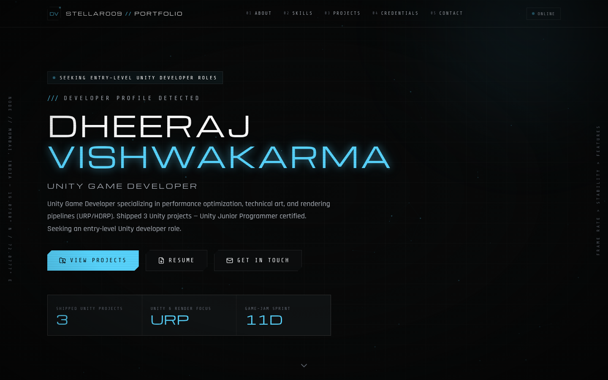

<div align="center">

# STELLAR009 // PORTFOLIO

**A sci-fi HUD-styled portfolio for Dheeraj Vishwakarma — Unity Game Developer**

[](https://stellar009-portfolio.netlify.app)
[](https://stellar009.itch.io/)
[](https://github.com/stellar009)




</div>

## 01 /// Overview

A single-page developer portfolio with a dark sci-fi command-terminal aesthetic, inspired by the official [Punishing: Gray Raven](https://pgr.kurogame.net) website. It presents three shipped Unity projects, skills, credentials and contact channels behind a full HUD interface — boot sequence, glitch typography, scanlines, a particle field and angled clip-path panels.

The whole page is data-driven: profile, projects, skills, credentials and navigation are defined in a single file (`src/components/portfolio/data.ts`), so content updates never require touching component code.

## 02 /// Features

- **System boot sequence** — terminal-style boot overlay with progress bar, click-to-skip and `prefers-reduced-motion` support
- **HUD navigation** — fixed nav with a scroll progress bar, active-section tracking and a mobile drawer menu
- **Glitch hero** — RGB-split glitch effect on the name, live status badge, CTA row with a resume download button
- **Particle field** — lightweight canvas particle background
- **CRT treatment** — scanlines, vignette, tech grid and HUD corner brackets throughout
- **Mission-log project cards** — angled clip-path cards with key results, tech-stack tags and live links to builds and source
- **Scroll-reveal animations** — sections and cards animate in with Framer Motion as they enter the viewport
- **Single source of content** — all text and data lives in one `data.ts` file
- **Responsive** — mobile-first layout, collapsible nav, fluid typography
- **Clean build** — strict TypeScript, ESLint clean, fully prerendered static output

## 03 /// Tech Stack

| Layer | Tech |
| --- | --- |
| Framework | Next.js 16 (App Router) · React 19 |
| Language | TypeScript 5 |
| Styling | Tailwind CSS 4 · custom PGR design tokens as CSS variables |
| Animation | Framer Motion 12 |
| Icons | lucide-react |
| Typography | Michroma · Rajdhani · Share Tech Mono (self-hosted via `next/font`) |

## 04 /// Project Structure

```
├── public/
│   ├── logo.svg
│   ├── robots.txt
│   └── resume/                          # downloadable resume PDF
├── src/
│   ├── app/
│   │   ├── layout.tsx                   # fonts + metadata
│   │   ├── page.tsx                     # section assembly
│   │   └── globals.css                  # PGR theme: colors, glitch, scanlines, HUD corners
│   ├── components/
│   │   ├── portfolio/
│   │   │   ├── data.ts                  # ★ ALL site content (profile, projects, skills…)
│   │   │   ├── boot-screen.tsx          # boot overlay (lines + timing)
│   │   │   ├── hud-nav.tsx              # fixed nav + scroll progress
│   │   │   ├── hero.tsx                 # glitch name, CTAs, stats
│   │   │   ├── marquee.tsx              # tech ticker
│   │   │   ├── about.tsx                # profile + quick facts
│   │   │   ├── skills.tsx               # capability matrix
│   │   │   ├── projects.tsx             # mission-log project cards
│   │   │   ├── credentials.tsx          # education / certification / game jams
│   │   │   ├── contact.tsx              # comm link + directory
│   │   │   ├── section-header.tsx       # numbered section headers + reveal helper
│   │   │   ├── particle-field.tsx       # canvas particles
│   │   │   └── site-footer.tsx
│   │   └── ui/                          # toast components
│   ├── hooks/                           # toast hook
│   └── lib/                             # small utilities
├── next.config.ts
├── tsconfig.json · eslint.config.mjs · postcss.config.mjs
```

## 05 /// Getting Started

Requires **Node.js 20.9+**.

```bash
git clone https://github.com/stellar009/Portfolio.git
cd Portfolio
npm install
npm run dev        # http://localhost:3000
```

| Command | Description |
| --- | --- |
| `npm run dev` | Start the development server |
| `npm run build` | Create a production build |
| `npm run start` | Serve the production build |
| `npm run lint` | Run ESLint |

## 06 /// Customization

- **Content** — edit `src/components/portfolio/data.ts`: profile info, stats, projects (with mission-log highlights and links), skills, credentials and nav labels.
- **Boot sequence** — boot lines and timing constants live in `src/components/portfolio/boot-screen.tsx`.
- **Theme** — palette (cyan `#59d6ff`, red `#ff4757`, amber `#ffb454`, background `#080909`), scanlines, glitch and clip-path utilities are defined in `src/app/globals.css`.
- **Resume** — replace the PDF in `public/resume/` (update the `RESUME` entry in `data.ts` if the filename changes).

## 07 /// Deployment

The site is live at **[stellar009-portfolio.netlify.app](https://stellar009-portfolio.netlify.app)**.

To deploy your own copy on Netlify:

1. Push this repo to GitHub.
2. In Netlify: **Add new site → Import an existing project → GitHub** and select the repo.
3. Netlify auto-detects Next.js — keep the defaults (build command `npm run build`) and deploy.

Every push to `master` then redeploys automatically, and pull requests get their own preview URLs.

## 08 /// Acknowledgements

- Visual design inspired by the official [Punishing: Gray Raven](https://pgr.kurogame.net) website by Kuro Games. This is a fan-made portfolio homage — not affiliated with or endorsed by Kuro Games.

---

<div align="center">

**Built by Dheeraj Vishwakarma (STELLAR009)** · [dheeraj32vi@gmail.com](mailto:dheeraj32vi@gmail.com)

[GitHub](https://github.com/stellar009) · [LinkedIn](https://www.linkedin.com/in/dheeraj-vishwakarma-4a5b76351/) · [itch.io](https://stellar009.itch.io/)

</div>
